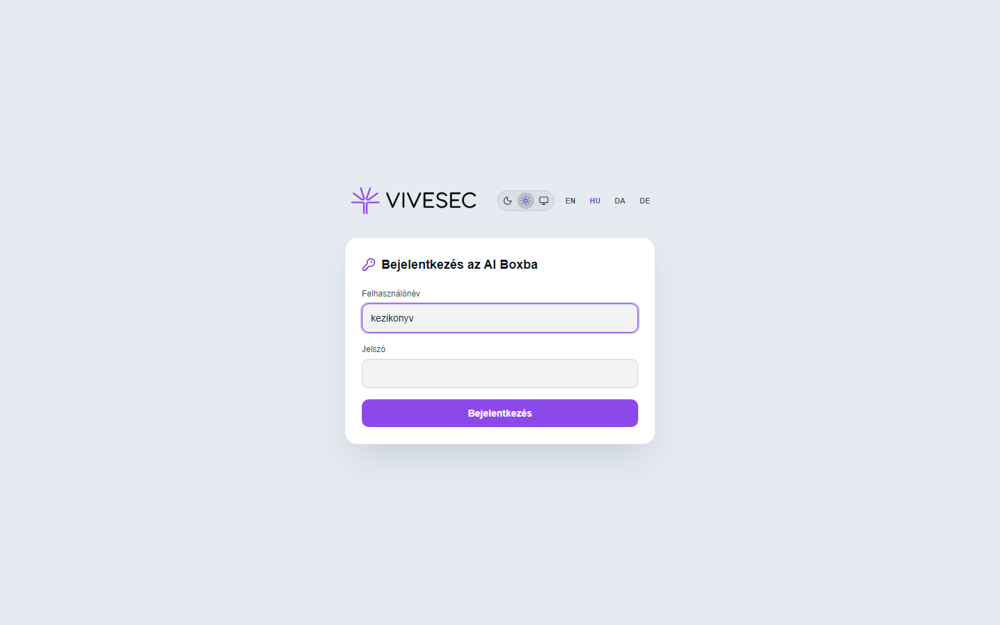
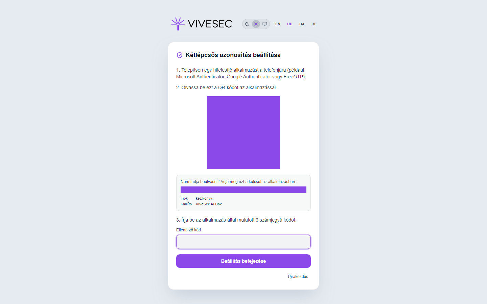
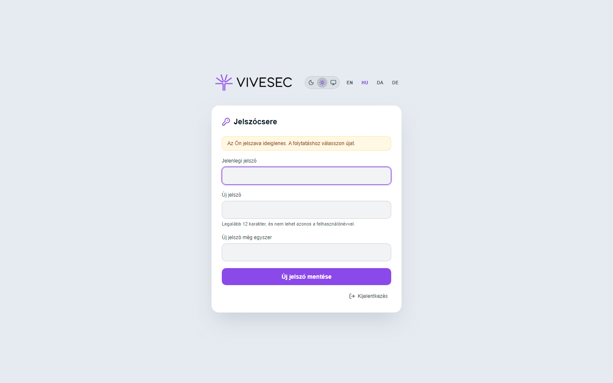
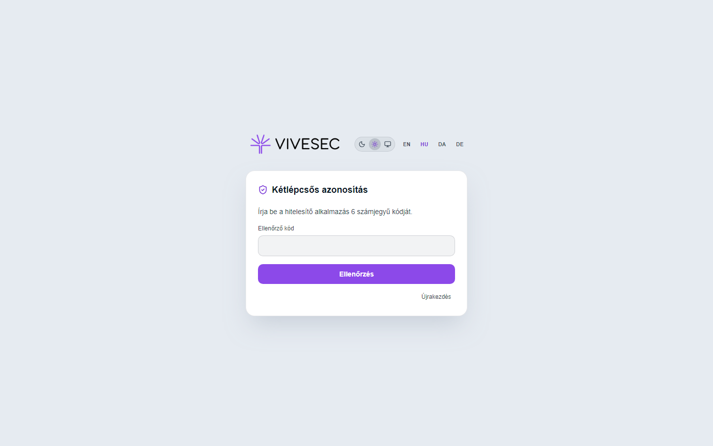
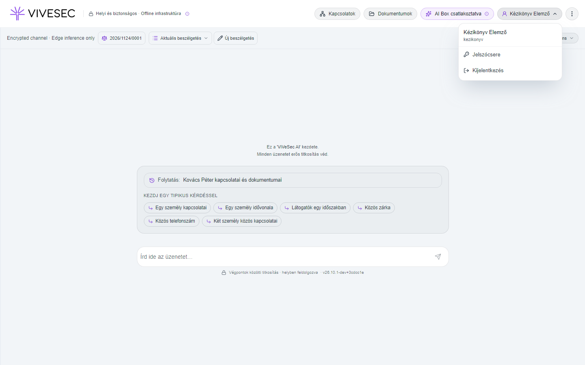
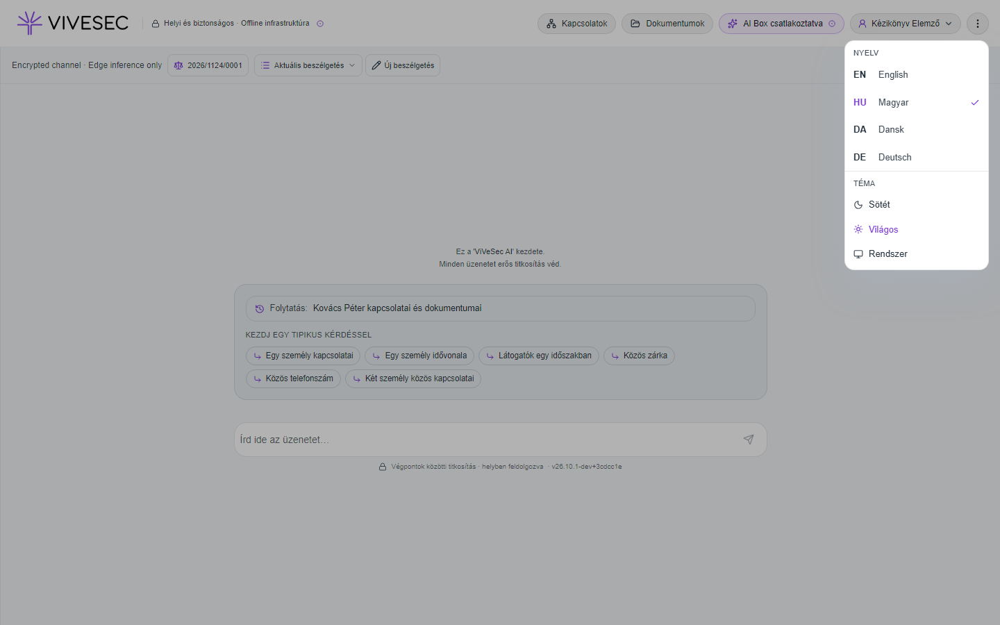

# 2. Belépés, jelszó, kétlépcsős azonosítás

[← Tartalom](index.md)

Ez a fejezet az önálló (böngészős) használatra vonatkozik. Ha a Matrix AI-t a ViVeSecBox
felületén belül használja, a belépést a ViVeSecBox végzi, és ez a fejezet kimarad.

## Mire lesz szüksége

- a rendszergazdától kapott **felhasználónévre** és **kezdő jelszóra**;
- egy **hitelesítő alkalmazásra** a telefonján, például Microsoft Authenticator, Google
  Authenticator vagy FreeOTP.

A bejelentkezési oldal jobb felső sarkában a nyelv (**EN**, **HU**, **DA**, **DE**) és a
megjelenés (sötét, világos, rendszer szerinti) is átállítható.

## Az első belépés

### 1. Felhasználónév és jelszó

Nyissa meg a rendszergazdától kapott címet, adja meg a felhasználónevét és a kezdő jelszavát,
majd kattintson a **Bejelentkezés** gombra.

### 2. A kétlépcsős azonosítás beállítása

Az első belépéskor megjelenik a **Kétlépcsős azonosítás beállítása** oldal:

1. Telepítse a hitelesítő alkalmazást a telefonjára.
2. Olvassa be az alkalmazással a képernyőn látható QR-kódot. Ha ez nem megy, válassza az
   alkalmazásban a kulcs kézi megadását, és írja be a **Nem tudja beolvasni? Adja meg ezt a
   kulcsot az alkalmazásban** alatt látható kulcsot.
3. Írja be az **Ellenőrző kód** mezőbe az alkalmazás által mutatott 6 számjegyű kódot, és
   kattintson a **Beállítás befejezése** gombra.

> **Fontos:** a QR-kódot és a kulcsot senkinek ne mutassa meg, és ne fényképezze le. Aki
> ismeri, az Ön nevében kódot tud előállítani. Ha elvesztette a telefonját, kérje a
> rendszergazdától a kétlépcsős azonosítás visszaállítását.

### 3. Új jelszó megadása

Ha a jelszava ideiglenes, a rendszer a következő lépésben új jelszót kér (**Az Ön jelszava
ideiglenes. A folytatáshoz válasszon újat.**). Adja meg a jelenlegi jelszót, majd kétszer az
újat, és kattintson az **Új jelszó mentése** gombra.

A jelszóra vonatkozó szabályokat a mező alatti tipp mutatja: legalább a megadott számú
karakter (alapértelmezésben 12), és nem lehet azonos a felhasználónévvel. A túl egyszerű,
ismétlődő karakterekből álló jelszót a rendszer elutasítja.

## A további belépések

A felhasználónév és a jelszó után a **Kétlépcsős azonosítás** oldal a hitelesítő alkalmazás
aktuális kódját kéri. Írja be, és kattintson az **Ellenőrzés** gombra. Az **Újrakezdés**
visszavisz az első lépéshez.

A kód 30 másodpercenként változik. Ha a rendszer nem fogadja el, várja meg a következő kódot,
és ellenőrizze, hogy a telefon órája pontos-e (a telefon beállításaiban az automatikus idő
legyen bekapcsolva).

## Jelszócsere és kijelentkezés

A jobb felső sarokban a nevére kattintva nyílik a **fiókmenü**:

- **Jelszócsere** — a jelenlegi és az új jelszó megadásával. Csere után a többi
  munkamenete kijelentkezik.
- **Kijelentkezés** — a munkamenet lezárása. Közös vagy felügyelet nélkül hagyott gépen mindig
  jelentkezzen ki.
- **Adminisztráció** — csak rendszergazdáknak látszik (lásd [7. fejezet](07-adminisztracio.md)).

Ha a rendszergazda egyetlen szobát sem rendelt Önhöz, a fiókmenüben ez áll: **Még nincs Önhöz
rendelt szoba. Kérjen hozzáférést a rendszergazdától.** Ilyenkor a kérdésekre nem érkezhet
dokumentumalapú válasz.

Ha a fiókot Active Directory kezeli, a jelszót nem itt, hanem a Windows-gépén kell
megváltoztatni; erre a felület figyelmeztet.

## Nyelv és megjelenés

A jobb felső sarok **⋮** (**Beállítások**) gombja alatt választható a felület nyelve
(**Magyar**, **English**, **Dansk**, **Deutsch**) és a téma (**Sötét**, **Világos**,
**Rendszer**). A választást a böngésző megjegyzi.

