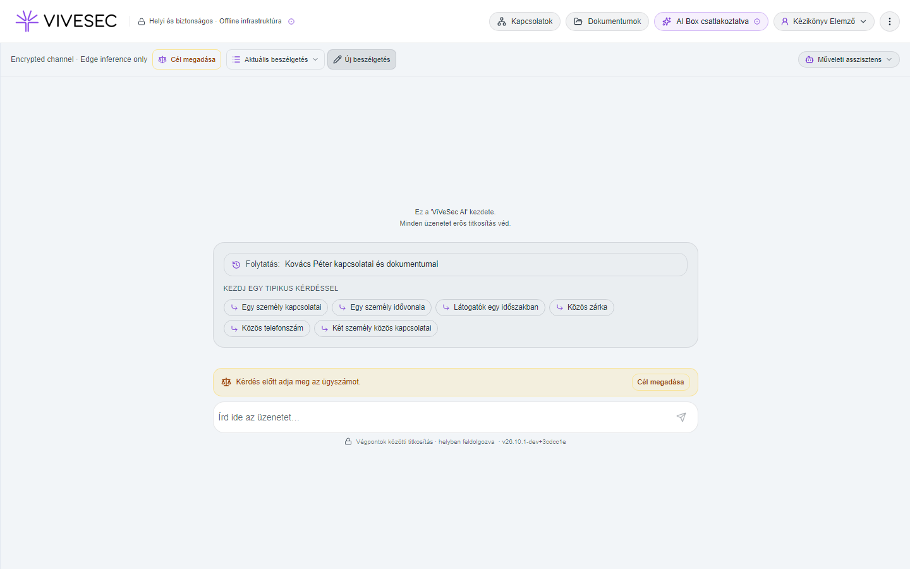
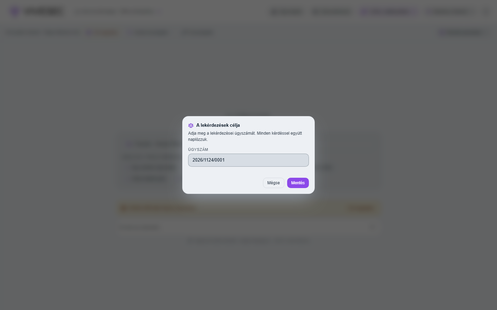
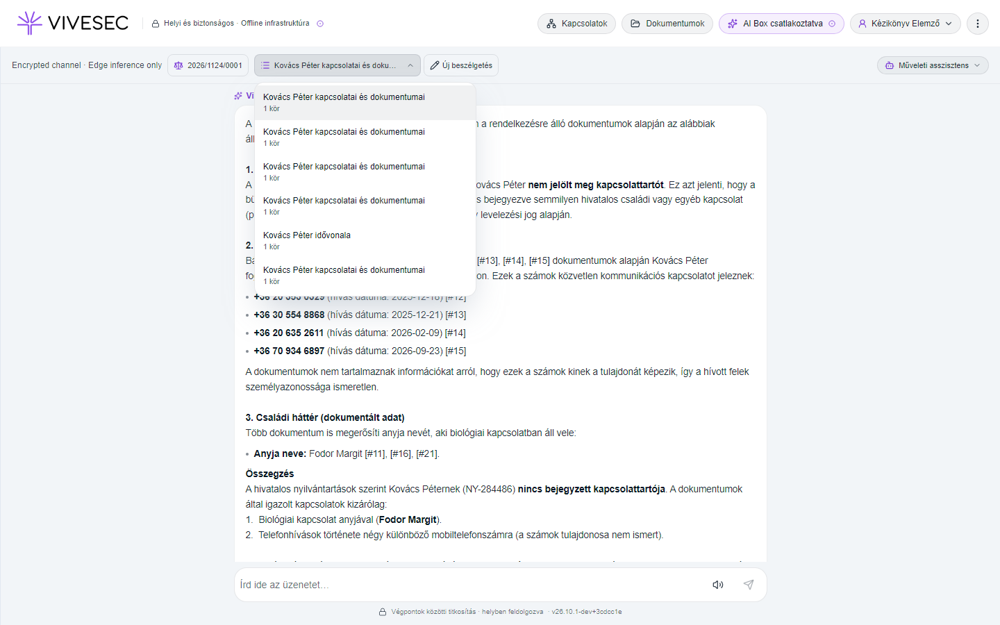

# 3. Kérdezés és beszélgetések

[← Tartalom](index.md)

## A főképernyő

| Hely | Elem | Mire való |
| --- | --- | --- |
| Fejléc | **Kapcsolatok** | A kapcsolatelemzés megnyitása ([6. fejezet](06-kapcsolatok.md)). |
| Fejléc | **Dokumentumok** | A szobák dokumentumainak böngészése ([5. fejezet](05-dokumentumok.md)). Csak önálló módban. |
| Fejléc | **AI Box csatlakoztatva** | A kapcsolat állapota. Ha a felirat mást mutat, a válaszadás nem elérhető. |
| Fejléc | az Ön neve | Fiókmenü: jelszócsere, kijelentkezés ([2. fejezet](02-belepes.md)). |
| Fejléc | **⋮** | Nyelv és téma. |
| Eszközsor | **Cél megadása** | A lekérdezések céljának (ügyszámának) megadása. |
| Eszközsor | **Aktuális beszélgetés** | A korábbi beszélgetések listája. |
| Eszközsor | **Új beszélgetés** | Üres beszélgetés indítása. |
| Középen | **Kezdj egy tipikus kérdéssel** | Kész kérdéssablonok. |
| Alul | **Írd ide az üzenetet…** | A kérdés beírása. |

## 1. lépés: a cél megadása

Kérdezés előtt meg kell adni, milyen ügyben kérdez. Amíg ez hiányzik, a beviteli mező felett a
**Kérdés előtt adja meg az ügyszámot.** figyelmeztetés látszik, és a kérdés nem küldhető el.

1. Kattintson a **Cél megadása** gombra.
2. Az **Ügyszám** mezőbe írja be az ügyszámot a kért formában (a mezőben szürkén látszik egy
   példa, például `2026/1113/2310`). Hibás formánál a mező alatt **Az ügyszám formája nem
   megfelelő.** üzenet jelenik meg.
3. Kattintson a **Mentés** gombra.

A megadott ügyszám ezután az eszközsorban látszik; rákattintva módosítható. Az ügyszám minden
kérdéssel együtt naplózódik, és a böngészőlap bezárásáig érvényes. A telepítéstől függően
ügyszám helyett vagy mellett jogalap is kérhető.

## 2. lépés: a kérdés

Írja be a kérdést a képernyő alján lévő mezőbe, és nyomja meg az **Enter** billentyűt, vagy
kattintson a küldés (papírrepülő) ikonra. Új sort a **Shift + Enter** kezd.

Jó kérdés:

- **konkrét**: nevet, azonosítót, időszakot tartalmaz, például „Kik Kovács Péter
  (NY-284486) kapcsolatai, és milyen dokumentumok említik?”;
- **egyértelmű**: azonos nevű személyeknél adja meg az azonosítót (például a nyilvántartási
  számot) is;
- **egy dologra kérdez**: összetett kérdés helyett kérdezzen többször, a beszélgetés
  megőrzi az előzményt.

A **Kezdj egy tipikus kérdéssel** sablonjai (például **Egy személy kapcsolatai**, **Egy
személy idővonala**, **Közös telefonszám**) beírják a kérdés elejét a mezőbe; a nevet vagy az
időszakot Önnek kell kiegészítenie, mielőtt elküldi.

A válasz általában néhány másodperc és egy-két perc között érkezik, attól függően, hány
dokumentumot kell átnéznie a rendszernek.

### Amíg a válasz készül

A kérdés alatt egy állapotjelző mutatja, hol tart a munka, és mennyi idő telt el. Rövid
kérdésnél ez **A helyi modell gondolkodik…**; több dokumentumot átfogó kérdésnél a lépéseket
is kiírja, például **Várakozás az elemzési sorra…**, **Az összes érintett részlet
összegyűjtése…**, **Részletek átnézése 3/12**, **Megállapítások összesítése**, **A válasz
megírása…**.

Néhány másodperc után az állapotjelző mellett megjelenik a **Leállítás** (négyzet) gomb. Ezzel
a kérdés megszakítható, ha rosszul fogalmazott, vagy túl sokáig tart; a beszélgetésben ekkor
**A kérdés leállítva.** áll. Válasz közben a beviteli mező zárolva van; a következő kérdést a
válasz után teheti fel.

A gép a nagy számításokat sorban végzi: ha egyszerre többen kérdeznek, a kérdés várakozhat
(**Várakozás az elemzési sorra…**). Ez nem hiba.

### Ha a rendszer visszakérdez

Ha a kérdés nem egyértelmű – például több azonos nevű személy van –, a rendszer válasz helyett
visszakérdez, és felsorolja a lehetőségeket (például a személyeket a megkülönböztető
adataikkal). A lehetőségek gombok: rákattintva a rendszer a kiválasztottal folytatja, mintha
beírta volna. Válaszolhat szövegesen is.

## Figyelt személyek

Ha a telepítésben a figyelőlista be van kapcsolva, a kapcsolatelemzésben egy személy
figyelésre jelölhető (**Figyelés**, lásd [6. fejezet](06-kapcsolatok.md)). Új beszélgetés
elején ekkor egy **Figyelt** kártya mutatja a figyelt személyeket, és hogy változott-e
valami (**Változott**: n, illetve **Nincs újdonság**):

- az **új** jelölésű sorok az utolsó megtekintés óta talált új kapcsolatok, a **+n dokumentum**
  sorok meglévő kapcsolatok új forrásai;
- a névre kattintva a rendszer a kérdésmezőbe írja: „Kikkel áll közvetlen kapcsolatban: …”
  (**Kérdezz rá**);
- a **Láttam** nyugtázza a változásokat, a **×** (**Figyelés vége**) leveszi a személyt a
  listáról;
- **Ebben a hatókörben most nem látható.** – a személy olyan dokumentumokból ismert, amelyek a
  most kiválasztott szobákban nincsenek.

## Beszélgetések

- A rendszer minden beszélgetést megjegyez, és az első kérdés alapján címet ad neki.
- Az eszközsor beszélgetésgombja (belépéskor **Aktuális beszélgetés**, később a beszélgetés
  címe) lenyitja a korábbi beszélgetéseket; mindegyik mellett látszik, hány körből áll.
  Kattintással visszanyitható.
- Az **Új beszélgetés** üres lappal indít. Új témánál mindig kezdjen új beszélgetést: így a
  korábbi kérdések nem befolyásolják a választ.
- Üres beszélgetésben a **Folytatás:** sor a legutóbbi beszélgetést kínálja fel.
- A listában egy beszélgetés fölé víve az egeret két ikon jelenik meg: a ceruza
  (**Beszélgetés átnevezése**) új nevet ad, az **×** (**Beszélgetés törlése**) megerősítés után
  törli. **A törlés nem vonható vissza.**

A beszélgetések felhasználónként, és a keresési körrel (a kiválasztott szobákkal) együtt
tárolódnak: más felhasználó nem látja őket, és egy szűkebb körű beszélgetésbe nem kerülhet át
tágabb körből származó előzmény. Ha egynél több szobához fér hozzá, és megváltoztatja, hogy
melyikben keres, a rendszer ezért új beszélgetést nyit.

## Felolvasás és diktálás

A beviteli mező hangszóró ikonja (**Utolsó válasz felolvasása**) felolvassa a legutóbbi
választ; felolvasás közben ugyanez a gomb állítja le (**Felolvasás leállítása**).

Ha a telepítés támogatja, a mezőben mikrofon ikon (**Kérdezés hanggal**) is megjelenik:

1. Kattintson a mikrofonra, és mondja el a kérdést (**Hallgatom… nyomd meg a négyzetet a
   küldéshez.**).
2. Kattintson a négyzetre (**Felvétel leállítása és küldés**).
3. A gép leírja a felvételt (**Átírás az AI Boxon…**), és a kérdést ugyanúgy dolgozza fel,
   mint a begépeltet.

A böngésző az első használatkor engedélyt kér a mikrofonhoz.

## A válaszadás módja

Ha a telepítés engedi, az eszközsoron két gomb közül választható a válaszadás módja:
**Dokumentumalapú** vagy **Hibrid** (a különbséget lásd a [4. fejezetben](04-valaszok.md)). A
két mód beszélgetései egymástól elkülönülnek; a választás az oldal újratöltéséig érvényes.
Ha a gombok nem látszanak, a módot a telepítés rögzíti.

## Új felületverzió

Frissítés után a beviteli mező felett ez jelenhet meg: **Elérhető a felület új verziója.**
Kattintson az **Újratöltés** gombra; a még el nem küldött szöveg megmarad (**Az el nem
küldött szöveg megmarad.**).

## Műveleti asszisztens

Az eszközsor jobb oldalán a **Műveleti asszisztens** az aktív AI-ügynököt mutatja
(**Napi műveletek és forgatókönyvek**). Elemző üzemmódban – ilyen a kapcsolatelemzésre
beállított telepítés – a kérdéssablonok jelennek meg; általános üzemmódban a beviteli mezőbe
írt `/` jel egy parancslistát nyit (például összefoglaló, jelentés, feljegyzés, prezentáció
készítése).
