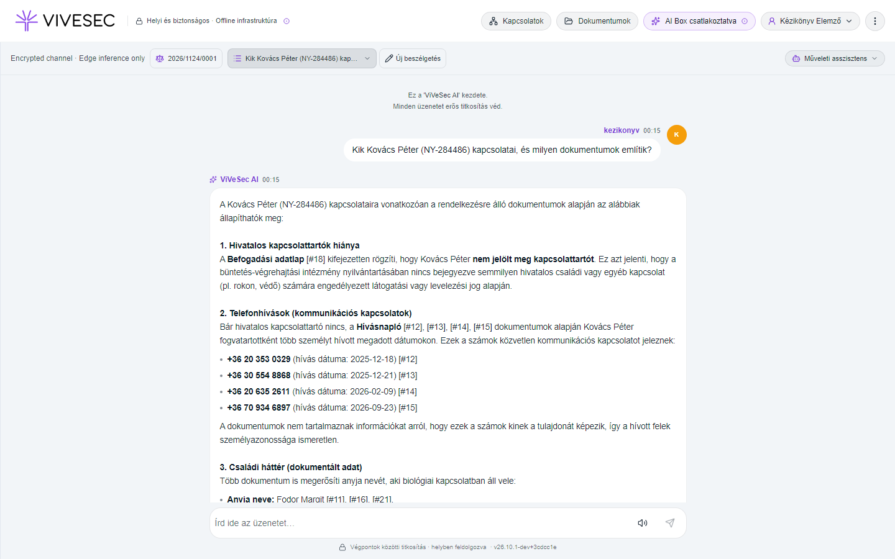
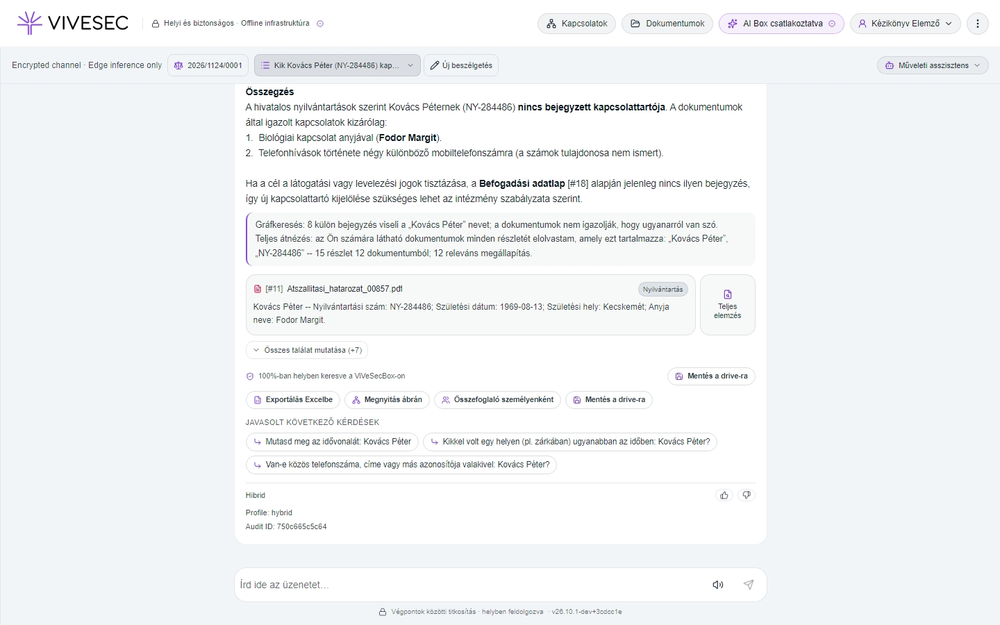
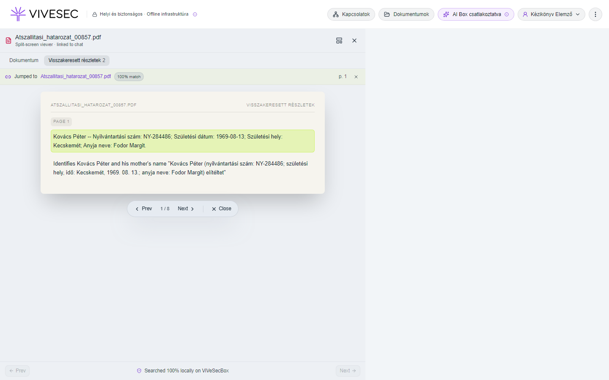
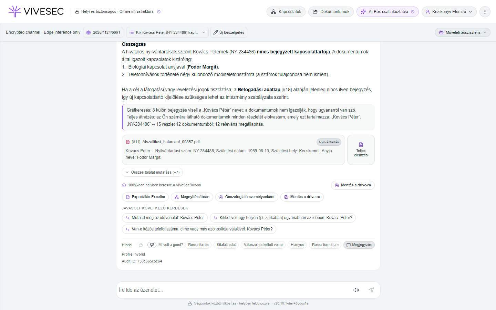

# 4. A válasz, a források és az értékelés

[← Tartalom](index.md)

## A válasz felépítése

A válasz a beszélgetésben, a kérdése alatt jelenik meg. Részei felülről lefelé:

1. **A válasz szövege.** Az állítások végén álló `[#12]` jel azt a dokumentumrészletet
   azonosítja, amelyből az állítás származik.
2. **A keresés összefoglalója** (bal oldalán lila vonallal). Megmutatja, mit és mennyit nézett át
   a rendszer, például: „Teljes átnézés: az Ön számára látható dokumentumok minden részletét
   elolvastam … 15 részlet 12 dokumentumból”. Ha azonos nevű, de nem bizonyítottan azonos
   személyeket talált, azt is itt jelzi.
3. **Források.** A legfontosabb hivatkozott részletek kártyái. Az **Összes találat mutatása**
   kibontja a többit is.
4. **Műveletek** (lásd lent), **Javasolt következő kérdések** és az **értékelés**.

> A válasz a dokumentumok alapján készül, de a nyelvi modell tévedhet: kihagyhat vagy
> félreérthet részleteket, és ritkán a forrásokban nem szereplő adatot is állíthat. Fontos
> döntés előtt mindig nyissa meg a hivatkozott forrást, a hibás választ pedig jelezze (lásd
> lent).

## A forrás megnyitása

Kattintson egy forráskártyára. A dokumentum a képernyő bal oldalán, osztott nézetben nyílik
meg:

- a **Dokumentum** fül az eredeti dokumentumot mutatja, a hivatkozott helyre ugorva;
- a **Visszakeresett részletek** fül a válaszhoz felhasznált szövegrészeket mutatja, kiemelve.
  A részletek között az alsó lapozógombokkal lehet lépkedni.

A nézet a jobb felső **×** gombbal zárható be.

A forrásnézőben előforduló jelzések:

- **Felismert szöveg (OCR) – felismerési hibákat tartalmazhat** – a részlet szkennelt képből,
  szövegfelismeréssel készült; betűhibák előfordulhatnak, döntés előtt nézze meg az eredeti
  oldalt.
- **Itt csak a dokumentum eleje látszik.** – hosszú szöveges dokumentumnál a nézet csak az
  elejét mutatja; a teljes szöveg az eredeti fájlban olvasható.
- **Ez a formátum nem jeleníthető meg a böngészőben.** – a fájl a megjelenő gombbal letölthető,
  és a saját programjával nyitható meg.

A forráslista **Összes találat mutatása** gombja kibontja az összes hivatkozott részletet, a
**Kevesebb találat** visszacsukja.

A forráskártya melletti **Teljes elemzés** gomb (ha megjelenik) az egész dokumentumot
elolvastatja és elemezteti. Nagy dokumentumnál ez percekig is tarthat.

## Műveletek a válaszon

A gombok a válasz típusától függően jelennek meg:

| Gomb | Mit csinál |
| --- | --- |
| **Mentés a drive-ra** | A választ fájlként menti a meghajtóra; a fájlnevet Ön adja meg. |
| **Exportálás Excelbe** | A vizsgálat eredményét táblázatként tölti le (személyekre vonatkozó kérdéseknél). |
| **Megnyitás ábrán** | A válaszban szereplő személyeket és kapcsolataikat a kapcsolatelemzés ábráján nyitja meg ([6. fejezet](06-kapcsolatok.md)). |
| **Összefoglaló személyenként** | Személyenkénti összefoglalókat készít háttérfeladatként. |
| **Javasolt következő kérdések** | Egy kattintással feltehető, a témához illő további kérdések. |

Az exportok és mentések naplózódnak. A Word-formátumú fájlok a rendszergazda által
beállított Word-sablon megjelenését követik ([7. fejezet](07-adminisztracio.md)).

## A válasz értékelése

A válasz alján a **Jó válasz** (felfelé mutató hüvelykujj) és a **Rossz válasz** (lefelé mutató
hüvelykujj) gombbal értékelheti a választ. Rossz válasznál a rendszer megkérdezi: **Mi volt a
gond?**

- **Rossz forrás** – a hivatkozott részlet nem támasztja alá az állítást;
- **Kitalált adat** – a válaszban olyan adat van, amely a forrásokban nem szerepel;
- **Válaszolnia kellett volna** – a válasz szerint nincs adat, pedig a dokumentumokban van;
- **Hiányos** – fontos rész kimaradt;
- **Rossz formátum** – a tartalom jó, de a forma nem megfelelő;
- **Megjegyzés** – szabad szöveges megjegyzés.

Az értékelés a válasz azonosítójával (**Audit ID**) együtt naplózódik, és a válaszminőség
javítását szolgálja. Az értékelés nem módosítja a választ.

A kártya alján látható címke a válaszadás módját (profilját) jelzi:

- **Dokumentumalapú**: a rendszer csak a dokumentumokból válaszol; ha azokban nincs válasz,
  ezt kimondja. Ilyenkor a címke mellett a **Megbízhatóság** pontszám is látszik (százalékban,
  zöld / sárga / piros színnel): azt becsüli, mennyire illeszkednek a talált részletek a
  kérdéshez, és mennyire támasztják alá a választ. Alacsony pontszámnál különösen fontos a
  források ellenőrzése.
- **Hibrid**: általános kérdésekre (magyarázat, megfogalmazás, javaslat) általános tudásból is
  válaszolhat, de a szervezetre és az ügyekre vonatkozó tényeket a dokumentumokra kell
  alapoznia, és a feltevéseket, javaslatokat el kell különítenie. Internetet ekkor sem használ.

A profilt a telepítés határozza meg. Ha a telepítés engedi, a felületen választani is lehet a
két profil között ([3. fejezet](03-kerdezes.md)); a két profil beszélgetései egymástól
elkülönülnek.
