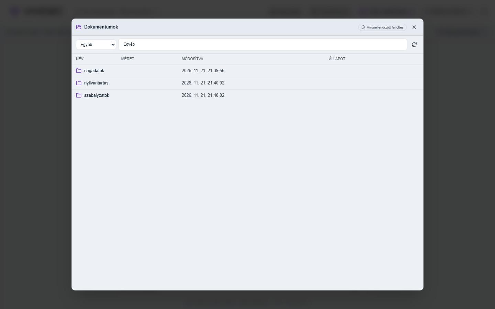

# 5. Dokumentumok

[← Tartalom](index.md)

A Matrix AI a hozzá rendelt szobák dokumentumaiból dolgozik. A fejléc **Dokumentumok** gombja
megnyitja a dokumentumtárat. Ez az ablak csak önálló (böngészős) módban érhető el;
ViVeSecBox-ba ágyazva a dokumentumokat a ViVeSecBox kezeli.

## A Dokumentumok ablak

- Bal felül a **szobaválasztó**: csak azok a szobák jelennek meg, amelyekhez hozzáfér.
- Mellette az aktuális útvonal; a mappanevekre kattintva lehet visszalépni.
- A **Frissítés** (körbe forduló nyíl) újratölti a listát.
- A táblázat oszlopai: **Név**, **Méret**, **Módosítva**, **Állapot**.
- A **Vírusellenőrzött feltöltés** jelvény azt jelzi, hogy minden feltöltött fájlt
  víruskereső ellenőriz, mielőtt bekerül a tárba.

Mappára kattintva beléphet, fájlra kattintva megnyílik a dokumentum. Az **Állapot** oszlop
mutatja, hogy a fájl kereshető-e már:

| Állapot | Jelentése |
| --- | --- |
| **Kereshető** | A fájl bekerült a keresési indexbe, a kérdések megtalálják. |
| **Még nem kereshető** | A feldolgozás még tart, vagy nem sikerült (lásd lent). |
| **Csak indexelve, az eredeti nincs a boxon** | Korábbi szinkronizálásból maradt; kereshető, de nem tölthető le. |

Soronként **Letöltés** és – jogosultság esetén – **Törlés** gomb is látszik.

## Feltöltés (dokumentumkezelőknek)

Feltölteni, mappát létrehozni és törölni csak az tud, akit a rendszergazda erre feljogosított
(alapértelmezésben a rendszergazdák). Nekik az ablak eszközsorában az **Új mappa**, a **Fájlok
feltöltése** és a **Mappa feltöltése** gomb is megjelenik, és a fájlok az ablakba húzással is
feltölthetők (**Ide húzva a fájlok feltöltődnek**). Mappát behúzni nem lehet: ehhez a **Mappa
feltöltése** gombot kell használni, amely az almappa-szerkezetet is megtartja.

**Támogatott fájltípusok** (alapértelmezés):

- szöveg: TXT, MD, CSV, TSV, JSON, LOG, XML, YAML, INI, RST;
- dokumentum: PDF, DOCX, PPTX, PPT, XLS, XLSX, XLSM, HTML, RTF;
- kép (szövegfelismeréssel): PNG, JPG, TIFF, BMP.

A fájlméret felső határa alapértelmezésben 20 MB. A nem engedélyezett vagy túl nagy fájlokat a
felület kihagyja, és jelzi, hányat hagyott ki.

Ha a mappában már van azonos nevű fájl, a rendszer megkérdezi: **Lecseréli őket?** – a
**Csere** felülírja, a **Kihagyás** kihagyja az ütköző fájlokat. A dokumentum cseréje így
történik: töltse fel újra ugyanazzal a névvel.

### A feltöltés állapota

A **Feltöltések** panel a saját feltöltéseit mutatja, és magától frissül:

| Állapot | Teendő |
| --- | --- |
| **Vírusellenőrzésre vár** | Nincs; az ellenőrzés hamarosan lefut. |
| **A víruskereső nem érhető el, karanténban marad** | A fájl biztonságban vár; értesítse a rendszergazdát. |
| **Indexelés…** | Nincs; a fájl hamarosan kereshető lesz. |
| **Indexelve, kereshető** | Kész. |
| **Eltárolva, de nem kereshető** / **túl nagy az indexeléshez** | A fájl a tárban van, de a kérdések nem találják meg. |
| **Vírust talált, a fájl törölve** | A fájlt a rendszer törölte; ellenőrizze a forrását. |
| **Nem sikerült ellenőrizni, a fájl elutasítva** | Próbálja újra, ha ismétlődik, szóljon a rendszergazdának. |

### Törlés

A **Törlés** a fájlt vagy a mappát a teljes tartalmával együtt eltávolítja a boxról és a
keresési indexből is. **A törlés nem vonható vissza.** Szobát itt nem lehet törölni, és
olyan mappát sem, amelyben Ön számára nem látható elem van.

## Nem olvasható dokumentumok

Ha egy dokumentumból nem nyerhető ki szöveg (például szkennelt kép szövegréteg nélkül,
sikertelen szövegfelismerés, nem támogatott vagy túl nagy fájl), a kérdések nem találják meg.
Ezek a dokumentumok a **Kapcsolatok › Feldolgozás** fülön, **A keresés számára nem
olvasható** szakaszban látszanak, okuk szerint csoportosítva. Jogosultság esetén itt az
**Újraolvasás** vagy a **Mind újraolvasása** újra megpróbálja a feldolgozást.

## Ki mit lát?

- A szobákat a rendszergazda rendeli a felhasználókhoz. Akinek a szoba nincs kiosztva, az nem
  látja, és a kérdései sem merítenek belőle.
- A szobán belül a rendszergazda mappákra további szabályokat állíthat (tiltás, engedélyezési
  lista, minősítési szint). A tiltás mindig erősebb az engedélynél.
- A minősített (például **Bizalmas**) dokumentumot csak az látja, akinek a jogosultsági
  szintje eléri a dokumentum minősítését.

A jogosultságot a rendszer minden kérdésnél újra ellenőrzi; amit Ön nem láthat, abból a válasz
sem idézhet.
