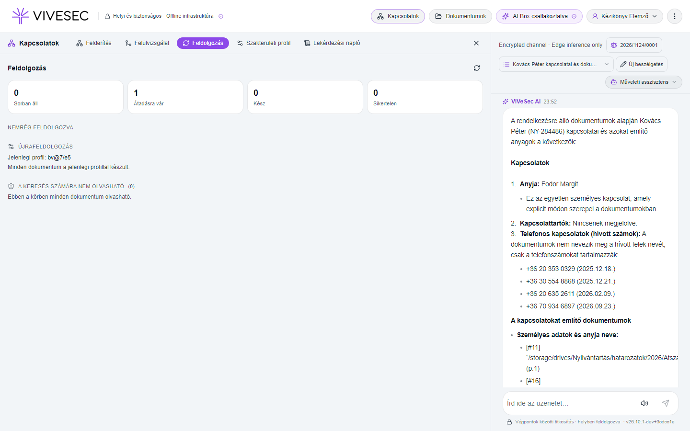
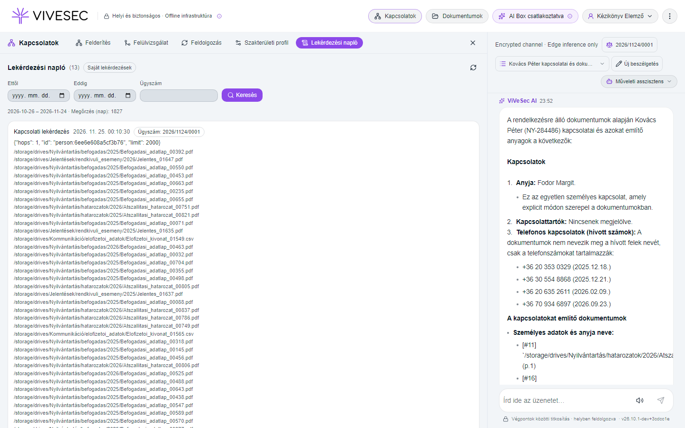

# 6. Kapcsolatelemzés

[← Tartalom](index.md)

A kapcsolatelemzés a dokumentumokból kinyert **entitásokat** – személyeket, szervezeteket,
helyeket, azonosítókat (például telefonszámokat), eseményeket és tárgyakat – és a köztük lévő
kapcsolatokat mutatja ábrán. Minden kapcsolat mögött ott a bizonyíték: az a dokumentumrészlet,
amelyből a kapcsolat származik.

A fejléc **Kapcsolatok** gombja nyitja és zárja. Megnyitva a beszélgetés keskeny oszlopban a
jobb oldalon marad, így elemzés közben is lehet kérdezni. A kapcsolatelemzés is csak a cél
(ügyszám) megadása után használható; ha hiányzik, a panel tetején figyelmeztetés és **Cél
megadása** gomb jelenik meg.

A panel fülei:

| Fül | Tartalma |
| --- | --- |
| **Felderítés** | Keresés, ábra, entitás-adatlap. |
| **Felülvizsgálat** | Lehetséges azonos személyek párjai; az összevonásról vagy külön tartásról gráf-adminisztrátor dönt. |
| **Feldolgozás** | A dokumentumfeldolgozás állapota, nem olvasható dokumentumok, strukturált betöltés. |
| **Szakterületi profil** | Milyen entitásfajtákat és kapcsolattípusokat ismer a rendszer. |
| **Lekérdezési napló** | A saját (vezetőnek mindenki) kapcsolati lekérdezései. |

## Keresés

1. A **Felderítés** fülön írjon be egy nevet, számot vagy azonosítót a **Személyek,
   szervezetek, helyek, számok keresése…** mezőbe, és kattintson a **Keresés** gombra.
2. A találati lista az azonos nevű személyeket megkülönböztető adatokkal mutatja
   (nyilvántartási szám, születési dátum, anyja neve, születési hely). Válassza ki a keresett
   személyt.
3. A mező melletti választóval állítható, mekkora környezet jelenjen meg: **Közvetlen
   kapcsolatok** vagy **Két lépés**.

Ha nincs találat, a lista ezt írja: **Nincs találat az Ön számára látható dokumentumokban.**

## Az ábra és az adatlap

**Az ábra jelölései**

- A kör színe az entitás típusát, mérete azt jelzi, milyen gyakran szerepel a dokumentumokban.
- **Folytonos vonal**: nyilvántartásból (strukturált adatból) származó kapcsolat;
  **szaggatott vonal**: a dokumentum szövegéből kinyert kapcsolat; **pontozott vonal**: csak
  együtt említve. A vastagabb vonal több kapcsolatot jelent, a nyíl irányított kapcsolatot.
- A jobb oldali eszközsor **Jelmagyarázat** gombja mindezt az ábrán is megmutatja; a
  jelmagyarázat egy sorára kattintva az adott típus elrejthető vagy megjeleníthető.

**Egérrel**

| Művelet | Hatás |
| --- | --- |
| kattintás egy körre | kijelöli, és megnyitja az adatlapját |
| dupla kattintás | hozzáadja a kapcsolatait az ábrához |
| Shift + kattintás két körre | két entitás kijelölése (útkereséshez) |
| húzás | a kör rögzítése a helyén |
| kattintás egy vonalra | a kapcsolat bizonyítékainak megnyitása |
| görgetés | nagyítás, kicsinyítés |

Az ábra jobb oldali eszközsorán található a **Keresés az ábrán**, a nagyítás és kicsinyítés,
az **Igazítás a nézethez**, a **Teljes képernyő**, a **2D nézet** / **3D nézet** váltás, az
**Időszűrő** és az **Ábra mentése** (PNG vagy SVG kép). A mentett képre a rendszer ráírja az
Ön nevét és az ügyszámot, és a mentést naplózza.

**Az adatlap** (az ábra jobb oldalán) részei:

- **Más néven** – az entitás egyéb névváltozatai;
- **Tulajdonságok** – például születési dátum, születési hely, nyilvántartási szám;
- **Dosszié** – az entitásról összeállított összefoglaló letöltése (**Word**, **PDF**) vagy
  mentése (**Mentés a drive-ra**);
- **Kapcsolatok** – a kapcsolatok listája dátummal; egy sorra kattintva megnyílik a
  kapcsolat bizonyítéka a szó szerinti idézettel és a forrásdokumentum oldalszámával;
- **Idővonal** – a dátummal ellátott kapcsolatok időrendben.

A **Kapcsolatai hozzáadása az ábrához** gomb a kiválasztott entitás környezetével bővíti az
ábrát; a **Vissza** gomb a korábbi ábrára lép vissza. Ha a telepítésben engedélyezett, a
**Figyelés** gombbal az entitás figyelőlistára tehető: új beszélgetés elején a rendszer
jelzi, ha változás történt vele kapcsolatban.

## Útkeresés és közös kapcsolatok

- **Kapcsolat ehhez…** – a kiválasztott entitásból a legrövidebb kapcsolati láncot keresi egy
  másik entitásig (legfeljebb 6 lépés).
- Shift + kattintással kijelölt két entitásnál az ábra alján megjelenő sávban a **Legrövidebb
  út** kiemeli a kettő közötti utat, a **Közös kapcsolatok** pedig a közös ismerősöket
  (ez csak az ábrán már látható adatokból számol).

## Időszűrő

Ha a kapcsolatok dátumot is hordoznak, az **Időszűrő** csúszkáival (**Időszak kezdete**,
**Időszak vége**) egy időszakra szűkíthető az ábra. **Az időszak lejátszása** havonta lépteti
az időszakot. A **Dátum nélküli kapcsolatok is** jelölőnégyzettel a dátum nélküli kapcsolatok
is láthatók maradnak.

## A válaszból az ábrára

A beszélgetésben adott válasz alatti **Megnyitás ábrán** gomb a válaszban vizsgált személyeket
és kapcsolataikat közvetlenül az ábrán nyitja meg. Fordítva: ha a kérdésben ismert személy
neve szerepel, a válasz a kapcsolatelemzés adatait is felhasználja, hivatkozással.

A **Megnyitás ábrán** egy **Vizsgálat** nézetet nyit: a kiinduló személy (**Kiindulópont**)
és a hozzá szintenként (**1. szint**, **2. szint** …) kapcsolódó személyek listáját, mellette az
ábrát. Egy személyre kattintva látszik, milyen láncon kapcsolódik a kiindulóponthoz
(**Kapcsolódás útja**), és ha több úton is, azok is (**További szál**). Ha a vizsgálat túl sok
személyt érintene, a felület jelzi: **A vizsgálat csonkolva van; további személyek is
lehetnek.** Egy személy adatlapjáról a **Vissza a vizsgálathoz** gombbal lehet visszatérni.

## Felülvizsgálat: lehetséges azonos személyek

Ugyanaz a személy több dokumentumban, több rekordként is szerepelhet. Ha a rekordokat erős
egyezés köti össze (például azonos azonosító szám, vagy azonos név és születési dátum), a
rendszer magától egy személlyé vonja össze őket. Ha az egyezés bizonytalan – például csak a név
azonos –, a két rekord külön marad, és a pár a **Felülvizsgálat** fülre kerül, ahol egy ember
dönti el, hogy ugyanarról a személyről van-e szó.

A fül két nézete:

- **Nyitott párok** – a még eldöntetlen párok (**Lehetséges azonos személy**, mellette a
  számuk);
- **Döntések** – a korábbi döntések.

A párokat mindenki láthatja, akinek a kapcsolatelemzés elérhető, de dönteni csak
gráf-adminisztrátor tud (önálló módban ez az `admin` szerepkör). Más felhasználónak a fül
tetején ez áll: **Ezt csak gráf-adminisztrátor teheti meg.** Mindenki csak azokat a párokat és
döntéseket látja, amelyek az Ön számára látható dokumentumokból származnak.

### A párok listája

Minden pár egy kártya: a két rekord neve (**A ↔ B**), jobbra pedig az ok és az egyezés
mértéke százalékban. Az ok azt mutatja, mi köti össze a két rekordot:

| Ok | Jelentése |
| --- | --- |
| **azonos név** | csak a név egyezik |
| **majdnem azonos név** | a név egy betűben tér el (elírás lehet) |
| **azonos vezetéknév és kezdőbetű** | például „Kovács P.” és „Kovács Péter” |
| **… + születési dátum** / **… + anyja neve** | a név mellett ez is egyezik |
| név + közös elérhetőség | a két rekord ugyanazt a telefonszámot, okmányt vagy címet használja |
| azonos azonosító szám, **eltérő név** | ugyanaz a nyilvántartási vagy azonosító szám más néven (elírás vagy kölcsönvett okmány lehet) |

Elöl azok a párok állnak, amelyeket a néven kívül más adat is alátámaszt, utánuk az egyezés
mértéke szerint; az azonos nevűek egymás után következnek, így egymással összevethetők.

**Szűrés**

- **Szűrés névre…** – a nevek egy részére szűr;
- **Minden ok** – egy adott okra szűkít (zárójelben a párok száma okonként);
- **Eltérő szerepű párok is** – alapértelmezésben rejtve vannak azok a párok, amelyekben két
  különböző szerepű rekordot (például egy fogvatartottat és egy látogatót) csak a név köt
  össze, mert ezek nagy valószínűséggel két különböző személyek. A jelölőnégyzettel ezek is
  megjeleníthetők.

### Egy pár részletei

A kártya összeveti a két rekordot:

- **Táblázat** az **1. rekord** és a **2. rekord** megkülönböztető adataival (születési dátum,
  anyja neve, azonosító számok, **Telefonok, okmányok, címek**). Soronként jelzi, hogy az adat
  **Egyezik**, **Ütközik**, **Eltér**, vagy csak az egyik rekordban szerepel (**Csak az 1.
  rekordban**, **Csak a 2. rekordban**). Ha egyik rekordban sincs ilyen adat, a kártya ezt írja:
  **Egyik rekord sem tartalmaz születési dátumot, anyja nevét vagy azonosítót.**
- **Rekordonként** a szerep (például fogvatartott, látogató; ha nincs: **Szerep nincs
  megadva**), a dokumentumok és kapcsolatok száma, a dokumentumok neve és a kapcsolatok szó
  szerinti idézettel. A dokumentumnévre vagy az idézetre kattintva megnyílik a forrás.
- **Mindkettő megnyitása a gráfban** – a **Felderítés** fülre vált, és kijelöli a két rekordot
  az ábrán, így megnézhető a köztük lévő legrövidebb út és a közös kapcsolataik.

Döntés előtt mindig nézze meg a forrásokat: az **Ütközik** jelzés (például eltérő születési
dátum) erősen arra utal, hogy két különböző személyről van szó.

### Döntés (gráf-adminisztrátoroknak)

Kártyánként:

- **Összevonás** – a két rekord egy személy lesz: nevei, adatai, dokumentumai és kapcsolatai
  egyesülnek, és a keresés, az ábra és a válaszok ezentúl egy személyként kezelik;
- **Külön tartás** – a két rekord két személy marad, és a pár nem kerül vissza a listára
  (hacsak a döntést vissza nem vonják).

A döntés után a kártyán **Összevonva.** vagy **Külön tartva.** áll, mellette a
**Visszavonás** gombbal azonnal visszacsinálható.

Több pár egyszerre is eldönthető: jelölje be a kártyák jelölőnégyzetét, vagy használja **A
látható mind kijelölése** lehetőséget (a sávban a **Kijelölve** szám mutatja, hány pár van
kijelölve), majd kattintson az **Összevonás** vagy a **Külön tartás** gombra, és erősítse meg
(**Megerősítés**). Az eredmény: **Eldöntve: n · Kihagyva: m**. Egy pár akkor marad ki, ha
közben megváltozott, például egy korábbi pár összevonása már érintette.

> Tömeges összevonás előtt szűrje a listát, és nézzen bele néhány párba: egy hibás összevonás
> összemossa két ember adatait, amíg vissza nem vonják.

### Döntések és visszavonás

A **Döntések** nézet a korábbi döntéseket mutatja a legújabbal kezdve: a két rekord, a döntés
(**Összevonva.** / **Külön tartva.**), ki és mikor döntött, és az akkori ok.

A gráf-adminisztrátor itt is visszavonhat egy döntést (**Visszavonás**). Ekkor a pár újra a
nyitott párok közé kerül (**Visszavonva — a pár újra felülvizsgálatra vár.**); összevonásnál a
két rekord újra különválik, és mindegyik visszakapja a saját dokumentumait. **Nem vonható
vissza** az a döntés, amely a visszavonás funkció bevezetése előtt született, vagy amelyre
később egy másik összevonás épült – ilyenkor előbb a későbbi összevonást kell visszavonni.

A felülvizsgálati lista és a döntések megnyitása is bekerül a **Lekérdezési naplóba**.

## Feldolgozás

A **Feldolgozás** fül mutatja, hol tart a dokumentumok feldolgozása (**Sorban áll**,
**Átadásra vár**, **Kész**, **Sikertelen**), melyik profillal készültek, és melyek nem
olvashatók. A feldolgozás akkor szünetel, amikor a box épp kérdésre válaszol.

### Strukturált betöltés (vezetőknek, gráf-adminisztrátoroknak)

Nyilvántartási exportok (például adatbázis-mentés vagy táblázat) a **Feldolgozás › Strukturált
betöltés** részben tölthetők be. Ez csak a jogosult szerepkörnek (alapértelmezésben `leader`)
és a gráf-adminisztrátoroknak látszik.

1. **Forrás**: válassza ki, melyik nyilvántartásból származik a fájl.
2. **Célmappa**: ahová a rekordok kerülnek. *Aki ezt a mappát láthatja, a rekordjait is látja.*
3. **Az export dátuma**: régebbi export soha nem írja felül az újabbat.
4. **A fájl tartalma**: **Csak a változások** vagy **A teljes nyilvántartás**.
5. **Exportfájl**: CSV, TSV, TXT, XLSX vagy XLSM, legfeljebb 50 MB. A rendszer ellenőrzi, hogy
   a fájlban megvannak-e a forrás oszlopai.
6. **Betöltés**. Az eredmény a sorok és rekordok számát (**Sorok**, **Rekordok**), az új, a
   frissült, a változatlan és a törölt rekordokat, valamint az esetleges problémákat mutatja
   (például **Hiányzó oszlopok**, **Ismeretlen kódok**, **Ismétlődő rekordazonosítók**,
   **Senki által nem látható rekordok (ismeretlen hozzáférési kód)**). Az **Új review-párok**
   a betöltés nyomán a **Felülvizsgálat** fülre került lehetséges azonos személyek száma. A
   **Kereső-másolat** azt jelzi, hogy a rekordok kereshető szövegként is bekerültek-e a
   kérdezéshez (**Várakozik**, **Frissítés…**, **Naprakész**).

Ha a teljes nyilvántartás betöltése sok rekordot törölne, a rendszer megáll, és csak a
**Betöltés mégis** gombbal folytatja – ez véd a véletlenül csonka exportfájl ellen. Az
exportdátumnál régebbi fájlt a rendszer kihagyja (**Régebbi export, kihagyva**).

**Ha a fájl oszlopai nem egyeznek.** Az ellenőrzés jelzi, ha a fájlból hiányoznak a forrás
oszlopai (**Hiányzó oszlopok (a betöltés nélkülük is lefut)**), vagy ha egy oszlopot más néven
talált (**Más néven megtalálva**). Ilyenkor a gráf-adminisztrátor két dolgot tehet:

- **Átnevezett oszlopok összerendelése** – ha a nyilvántartás exportjában egy oszlop neve
  megváltozott, egyszer kiválasztja, melyik a régi oszlop új neve (**Oszlopnevek mentése**); a
  rendszer ezután magától párosítja.
- **Új forrás felvétele ebből a fájlból** – ha a fájl egy még nem ismert nyilvántartásból
  származik: a rendszer a fejlécből és néhány sorból javaslatot tesz, melyik oszlop mit jelent
  (név, születési dátum, azonosító, telefonszám …); a gráf-adminisztrátor oszloponként
  ellenőrzi a **Szerepkört**, szükség esetén kapcsolatot ad hozzá (**Kapcsolat hozzáadása**),
  majd **Mentés új forrásként**. Az új forrás a szakterületi profil új verziójába kerül.

### Újrafeldolgozás (gráf-adminisztrátoroknak)

Ha a szakterületi profil megváltozik, a korábban feldolgozott dokumentumokat újra kell
olvasni, hogy az új szabályok rájuk is érvényesek legyenek. Az **Újrafeldolgozás** rész
mutatja a **Jelenlegi profil** verzióját és azt, hány dokumentum készült régebbi profillal
(**Régebbi vagy ismeretlen profillal feldolgozva**). A gráf-adminisztrátor a **Szűkítés**
mezővel egy mappára korlátozhatja, majd az **Újrafeldolgozás** gombbal elindítja; a
**Leállítás** megszakítja. Az újrafeldolgozás a nyelvi modellt használja, ezért sok
dokumentumnál hosszan tarthat; közben a kérdések elsőbbséget kapnak (**Az AI Box éppen
kérdésre válaszol; a kinyerés addig vár.**).

## Szakterületi profil

A **Szakterületi profil** fül megmutatja, milyen entitásfajtákat (például fogvatartott,
zárka, telefonszám) és kapcsolattípusokat (például „Felhívta”, „Elhelyezve”) keres a rendszer a
dokumentumokban. A profilt a telepítés választja ki; módosítani csak gráf-adminisztrátor tudja.

A gráf-adminisztrátornak két további eszköze van:

- **Javaslatok a dokumentumokból** – a **Javaslatok keresése** összegyűjti, milyen
  kapcsolatokat tudott a rendszer csak általánosként („Kapcsolatban áll”) felismerni, és milyen
  azonosítókat nem ismer egyik minta sem. A javaslatok egyenként elfogadhatók (**Elfogadás**),
  szerkeszthetők vagy elvethetők; az **Elfogadottak alkalmazása**, majd a **Mentés új
  verzióként** elkészíti a profil új verzióját.
- **Profil szerkesztése (JSON)** – a profil közvetlen szerkesztése szakértőknek; mentés:
  **Mentés új verzióként**.

A profil új verziója a már feldolgozott dokumentumokra csak **Újrafeldolgozás** után érvényes
(lásd fent).

## Lekérdezési napló

Minden kapcsolati lekérdezés naplózódik az ügyszámmal (és ha van, a jogalappal) és az érintett
dokumentumokkal együtt. A **Lekérdezési napló** fülön a saját lekérdezései (**Saját
lekérdezések**) szűrhetők dátum (**Ettől**, **Eddig**) és **Ügyszám** szerint, majd
**Keresés**.

- Vezető szerepkörrel a **Mindenki lekérdezései (vezető)** nézet is elérhető, **Felhasználó**
  szerinti szűréssel.
- A szűrők alatt látszik, meddig őrzi a rendszer a naplót (**Megőrzés (nap)**).
- Ha egy lekérdezés olyan dokumentumot is érintett, amelyhez Ön nem fér hozzá, annak neve
  helyett ez áll: **Az Ön számára nem látható dokumentumok**.
- Ha egy nap naplóját utólag módosították, a felület figyelmeztet: **Ennek a napnak a naplóját
  módosították: a hash-lánca megszakadt.** Ilyenkor értesítse a rendszergazdát.

## Korlátok

- Csak az Ön számára látható dokumentumokból származó entitások és kapcsolatok jelennek meg.
- Az ábrán legfeljebb 5000 csomópont fér el; nagyobb környezetnél csak az új csomópont
  környezete marad. A kapcsolatlista legfeljebb 2000 entitást mutat.
- Azonos nevű rekordokat a rendszer csak erős egyezésnél (például azonos azonosító szám, vagy
  azonos név és születési dátum) von össze magától; a bizonytalan párokról a **Felülvizsgálat**
  fülön kell dönteni, addig külön személyként szerepelnek.
- WebGL-gyorsítás nélküli gépen egyszerűsített, lassabb nézet jelenik meg.
