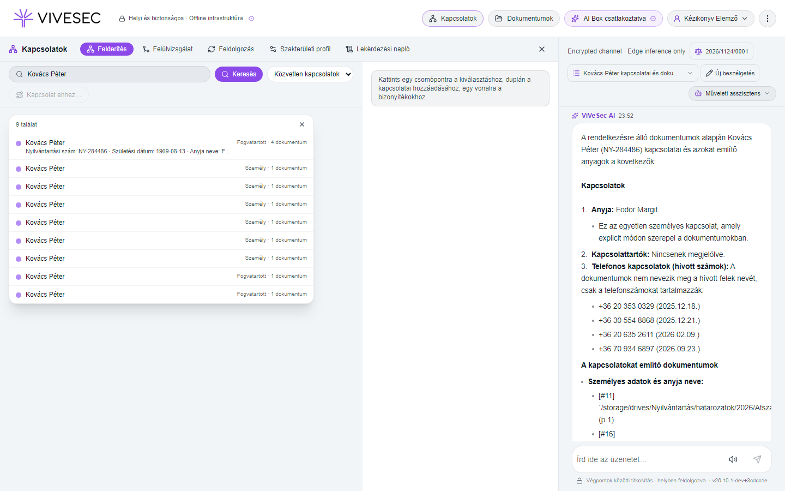
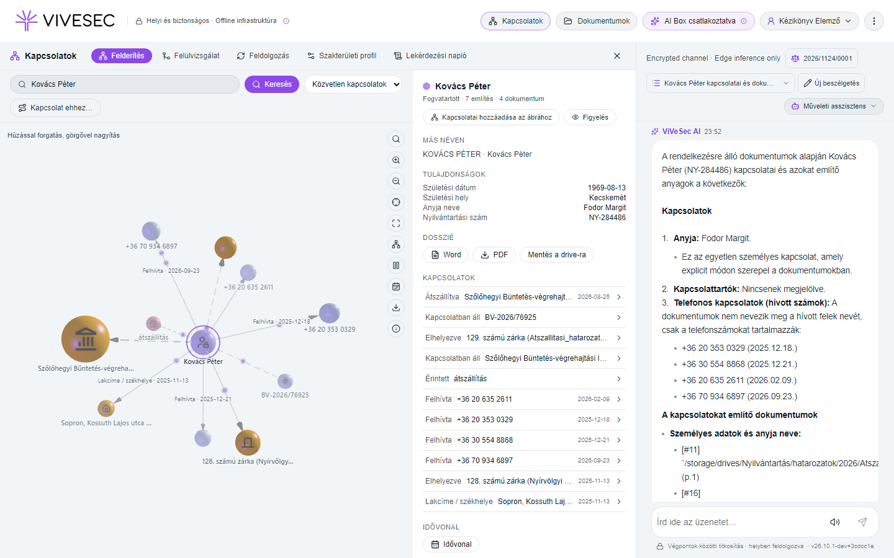
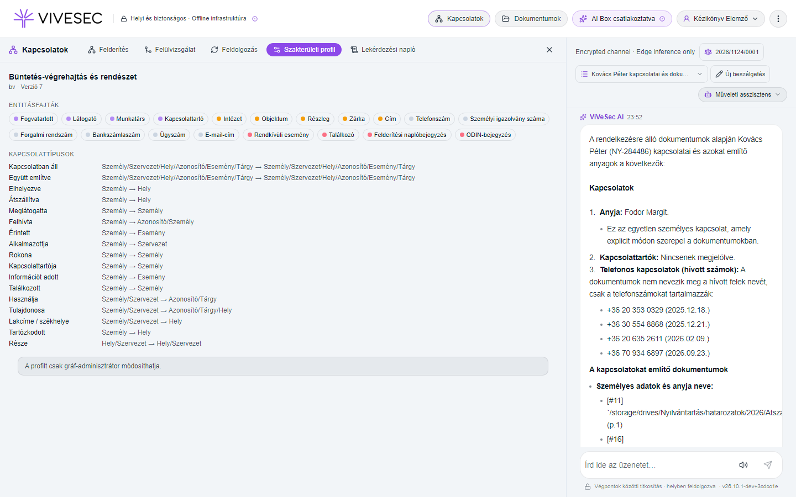

# 6. Kapcsolatelemzés

[← Tartalom](index.md)

A kapcsolatelemzés a dokumentumokból kinyert **entitásokat** – személyeket, szervezeteket,
helyeket, azonosítókat (például telefonszámokat), eseményeket és tárgyakat – és a köztük lévő
kapcsolatokat mutatja ábrán. Minden kapcsolat mögött ott a bizonyíték: az a dokumentumrészlet,
amelyből a kapcsolat származik.

A fejléc **Kapcsolatok** gombja nyitja és zárja. Megnyitva a beszélgetés keskeny oszlopban a
jobb oldalon marad, így elemzés közben is lehet kérdezni. A kapcsolatelemzés is csak a cél
(ügyszám) megadása után használható; ha hiányzik, a panel tetején figyelmeztetés és **Cél
megadása** gomb jelenik meg.

A panel fülei:

| Fül | Tartalma |
| --- | --- |
| **Felderítés** | Keresés, ábra, entitás-adatlap. |
| **Felülvizsgálat** | Lehetséges azonos személyek párjai (összevonásról csak gráf-adminisztrátor dönthet). |
| **Feldolgozás** | A dokumentumfeldolgozás állapota, nem olvasható dokumentumok, strukturált betöltés. |
| **Szakterületi profil** | Milyen entitásfajtákat és kapcsolattípusokat ismer a rendszer. |
| **Lekérdezési napló** | A saját (vezetőnek mindenki) kapcsolati lekérdezései. |

## Keresés

1. A **Felderítés** fülön írjon be egy nevet, számot vagy azonosítót a **Személyek,
   szervezetek, helyek, számok keresése…** mezőbe, és kattintson a **Keresés** gombra.
2. A találati lista az azonos nevű személyeket megkülönböztető adatokkal mutatja
   (nyilvántartási szám, születési dátum, anyja neve, születési hely). Válassza ki a keresett
   személyt.
3. A mező melletti választóval állítható, mekkora környezet jelenjen meg: **Közvetlen
   kapcsolatok** vagy **Két lépés**.

Ha nincs találat, a lista ezt írja: **Nincs találat az Ön számára látható dokumentumokban.**

## Az ábra és az adatlap

**Az ábra jelölései**

- A kör színe az entitás típusát, mérete azt jelzi, milyen gyakran szerepel a dokumentumokban.
- **Folytonos vonal**: nyilvántartásból (strukturált adatból) származó kapcsolat;
  **szaggatott vonal**: a dokumentum szövegéből kinyert kapcsolat; **pontozott vonal**: csak
  együtt említve. A vastagabb vonal több kapcsolatot jelent, a nyíl irányított kapcsolatot.
- A jobb oldali eszközsor **Jelmagyarázat** gombja mindezt az ábrán is megmutatja; a
  jelmagyarázat egy sorára kattintva az adott típus elrejthető vagy megjeleníthető.

**Egérrel**

| Művelet | Hatás |
| --- | --- |
| kattintás egy körre | kijelöli, és megnyitja az adatlapját |
| dupla kattintás | hozzáadja a kapcsolatait az ábrához |
| Shift + kattintás két körre | két entitás kijelölése (útkereséshez) |
| húzás | a kör rögzítése a helyén |
| kattintás egy vonalra | a kapcsolat bizonyítékainak megnyitása |
| görgetés | nagyítás, kicsinyítés |

Az ábra jobb oldali eszközsorán található a **Keresés az ábrán**, a nagyítás és kicsinyítés,
az **Igazítás a nézethez**, a **Teljes képernyő**, a **2D nézet** / **3D nézet** váltás, az
**Időszűrő** és az **Ábra mentése** (PNG vagy SVG kép). A mentett képre a rendszer ráírja az
Ön nevét és az ügyszámot, és a mentést naplózza.

**Az adatlap** (az ábra jobb oldalán) részei:

- **Más néven** – az entitás egyéb névváltozatai;
- **Tulajdonságok** – például születési dátum, születési hely, nyilvántartási szám;
- **Dosszié** – az entitásról összeállított összefoglaló letöltése (**Word**, **PDF**) vagy
  mentése (**Mentés a drive-ra**);
- **Kapcsolatok** – a kapcsolatok listája dátummal; egy sorra kattintva megnyílik a
  kapcsolat bizonyítéka a szó szerinti idézettel és a forrásdokumentum oldalszámával;
- **Idővonal** – a dátummal ellátott kapcsolatok időrendben.

A **Kapcsolatai hozzáadása az ábrához** gomb a kiválasztott entitás környezetével bővíti az
ábrát; a **Vissza** gomb a korábbi ábrára lép vissza. Ha a telepítésben engedélyezett, a
**Figyelés** gombbal az entitás figyelőlistára tehető: új beszélgetés elején a rendszer
jelzi, ha változás történt vele kapcsolatban.

## Útkeresés és közös kapcsolatok

- **Kapcsolat ehhez…** – a kiválasztott entitásból a legrövidebb kapcsolati láncot keresi egy
  másik entitásig (legfeljebb 6 lépés).
- Shift + kattintással kijelölt két entitásnál az ábra alján megjelenő sávban a **Legrövidebb
  út** kiemeli a kettő közötti utat, a **Közös kapcsolatok** pedig a közös ismerősöket
  (ez csak az ábrán már látható adatokból számol).

## Időszűrő

Ha a kapcsolatok dátumot is hordoznak, az **Időszűrő** csúszkáival (**Időszak kezdete**,
**Időszak vége**) egy időszakra szűkíthető az ábra. **Az időszak lejátszása** havonta lépteti
az időszakot. A **Dátum nélküli kapcsolatok is** jelölőnégyzettel a dátum nélküli kapcsolatok
is láthatók maradnak.

## A válaszból az ábrára

A beszélgetésben adott válasz alatti **Megnyitás ábrán** gomb a válaszban vizsgált személyeket
és kapcsolataikat közvetlenül az ábrán nyitja meg. Fordítva: ha a kérdésben ismert személy
neve szerepel, a válasz a kapcsolatelemzés adatait is felhasználja, hivatkozással.

## Feldolgozás

A **Feldolgozás** fül mutatja, hol tart a dokumentumok feldolgozása (**Sorban áll**,
**Átadásra vár**, **Kész**, **Sikertelen**), melyik profillal készültek, és melyek nem
olvashatók. A feldolgozás akkor szünetel, amikor a box épp kérdésre válaszol.

### Strukturált betöltés (vezetőknek, gráf-adminisztrátoroknak)

Nyilvántartási exportok (például adatbázis-mentés vagy táblázat) a **Feldolgozás › Strukturált
betöltés** részben tölthetők be. Ez csak a jogosult szerepkörnek (alapértelmezésben `leader`)
és a gráf-adminisztrátoroknak látszik.

1. **Forrás**: válassza ki, melyik nyilvántartásból származik a fájl.
2. **Célmappa**: ahová a rekordok kerülnek. *Aki ezt a mappát láthatja, a rekordjait is látja.*
3. **Az export dátuma**: régebbi export soha nem írja felül az újabbat.
4. **A fájl tartalma**: **Csak a változások** vagy **A teljes nyilvántartás**.
5. **Exportfájl**: CSV, TSV, TXT, XLSX vagy XLSM, legfeljebb 50 MB. A rendszer ellenőrzi, hogy
   a fájlban megvannak-e a forrás oszlopai.
6. **Betöltés**. Az eredmény mutatja a sorok, az új, a frissült és a törölt rekordok számát.

## Szakterületi profil

A **Szakterületi profil** fül megmutatja, milyen entitásfajtákat (például fogvatartott,
zárka, telefonszám) és kapcsolattípusokat (például „Felhívta”, „Elhelyezve”) keres a rendszer a
dokumentumokban. A profilt a telepítés választja ki; módosítani csak gráf-adminisztrátor tudja.

## Lekérdezési napló

Minden kapcsolati lekérdezés naplózódik az ügyszámmal és az érintett dokumentumokkal együtt.
A **Lekérdezési napló** fülön a saját lekérdezései szűrhetők dátum (**Ettől**, **Eddig**) és
**Ügyszám** szerint. Vezető szerepkörrel mindenki lekérdezései is megtekinthetők. Ha egy nap
naplóját utólag módosították, a felület ezt jelzi.

## Korlátok

- Csak az Ön számára látható dokumentumokból származó entitások és kapcsolatok jelennek meg.
- Az ábrán legfeljebb 5000 csomópont fér el; nagyobb környezetnél csak az új csomópont
  környezete marad. A kapcsolatlista legfeljebb 2000 entitást mutat.
- Azonos nevű személyeket a rendszer csak akkor von össze, ha erről a **Felülvizsgálat** fülön
  döntöttek; addig külön szerepelnek.
- WebGL-gyorsítás nélküli gépen egyszerűsített, lassabb nézet jelenik meg.
