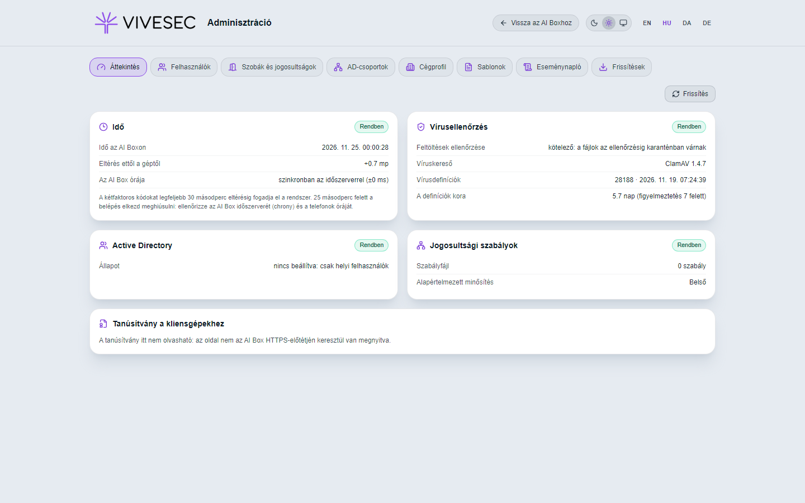
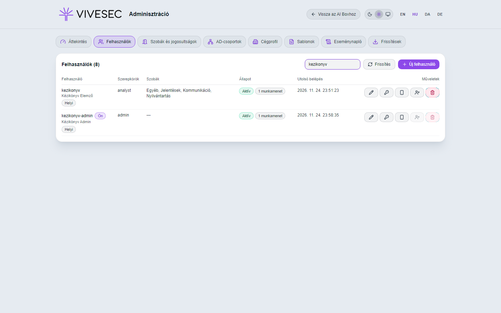
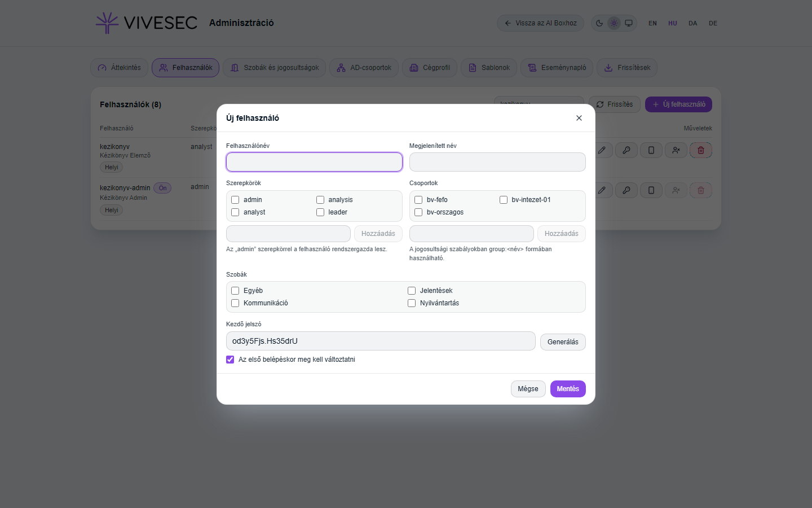
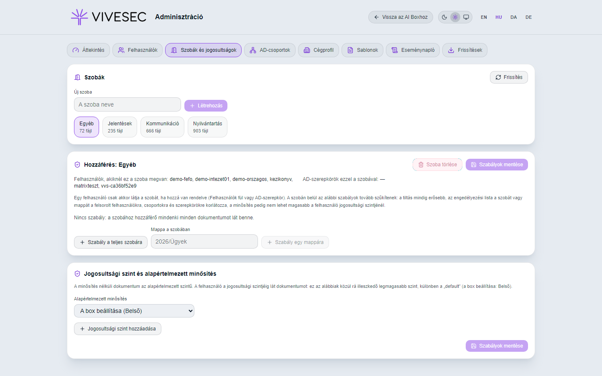
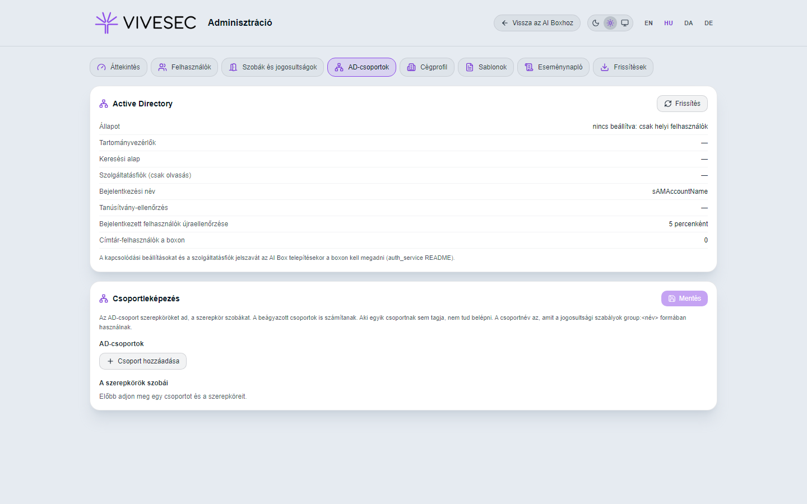
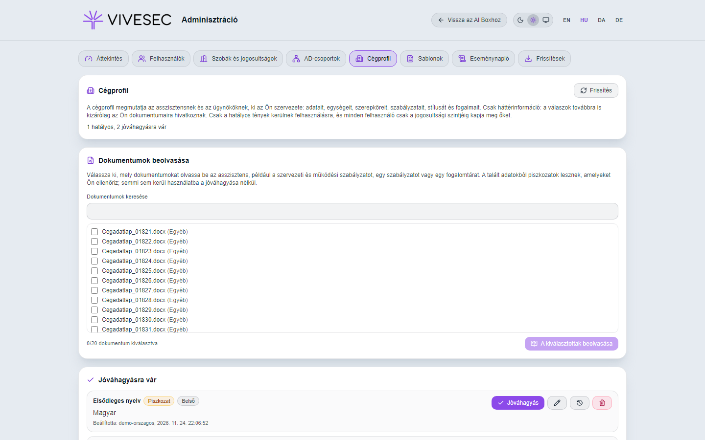
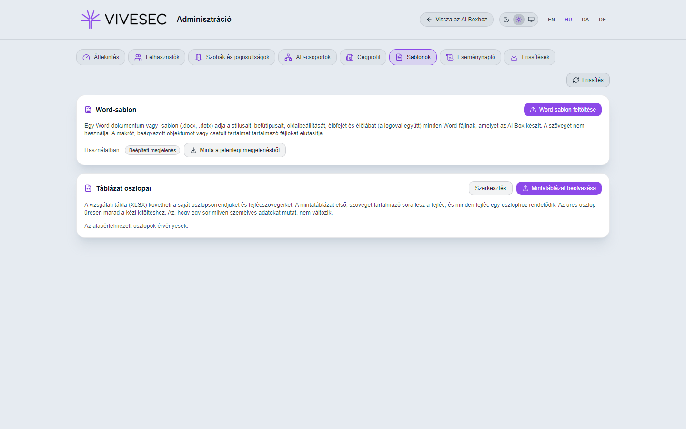
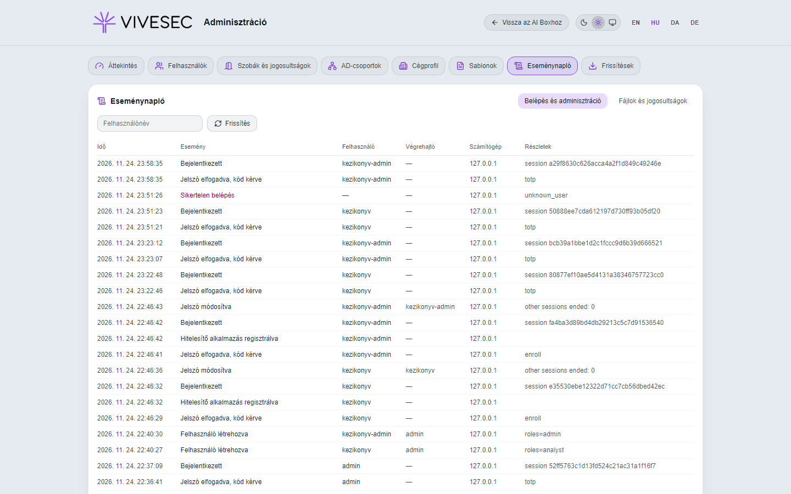
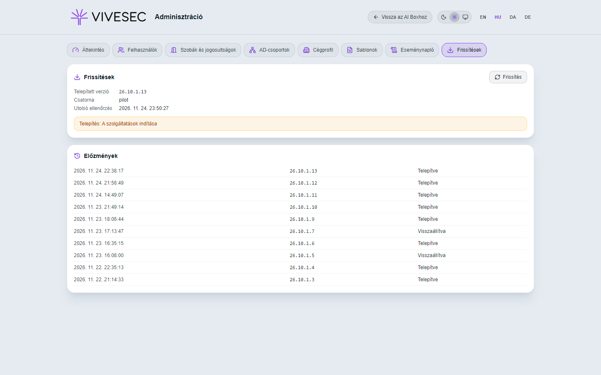

# 7. Adminisztráció

[← Tartalom](index.md)

Az adminisztrációs oldal az `admin` szerepkörű felhasználóknak érhető el: **fiókmenü ›
Adminisztráció**. Visszatérni a **Vissza az AI Boxhoz** gombbal lehet. A fülek:
**Áttekintés**, **Felhasználók**, **Szobák és jogosultságok**, **AD-csoportok**, **Cégprofil**,
**Sablonok**, **Eseménynapló**, **Frissítések**.

A rendszergazda a gép telepítését, mentését és a parancssori karbantartást a telepítési
kézikönyv szerint végzi; ez a fejezet csak a webes felületet írja le.

## Áttekintés

Az **Áttekintés** a működés szempontjából fontos állapotokat mutatja, mindegyiknél
**Rendben** vagy figyelmeztető jelzéssel:

- **Idő** – a box órája és az eltérés az Ön gépétől. A kétlépcsős kódokat a rendszer legfeljebb
  30 másodperc eltérésig fogadja el; ha a belépések kódhiba miatt meghiúsulnak, először ezt
  ellenőrizze.
- **Vírusellenőrzés** – a víruskereső verziója és a vírusdefiníciók kora (7 napnál régebbi
  definíciónál figyelmeztet).
- **Active Directory** – be van-e kötve címtár, vagy csak helyi felhasználók vannak.
- **Jogosultsági szabályok** – a szabályfájl állapota és az alapértelmezett minősítés.
- **Tanúsítvány a kliensgépekhez** – a HTTPS-tanúsítvány letöltése a kliensgépekre (csak a box
  HTTPS-címén megnyitva látszik).

## Felhasználók

A táblázat a felhasználókat mutatja szerepkörrel, szobákkal, állapottal és az utolsó
belépéssel. Az állapot oszlop jelzései: **Aktív**, **Felfüggesztve**, **Zárolva**, **2FA nincs
regisztrálva**, **Ideiglenes jelszó**, valamint a nyitott munkamenetek száma. A **Szűrés**
mezővel név szerint lehet keresni.

### Új felhasználó

1. Kattintson az **Új felhasználó** gombra.
2. Adja meg a **Felhasználónév** és a **Megjelenített név** mezőt.
3. Jelölje be a **Szerepköröket** (`analyst`, `leader`, `admin` …). *Az „admin” szerepkörrel
   a felhasználó rendszergazda lesz.*
4. Szükség esetén jelöljön be **Csoportokat**; ezekre a jogosultsági szabályok
   `group:<név>` alakban hivatkozhatnak.
5. Jelölje be a **Szobákat**, amelyekhez a felhasználó hozzáférhet.
6. Adjon meg **Kezdő jelszót**, vagy kérjen egyet a **Generálás** gombbal. Hagyja bekapcsolva
   **Az első belépéskor meg kell változtatni** jelölőt.
7. **Mentés**. A jelszót biztonságos csatornán adja át a felhasználónak; az első belépéskor
   regisztrálja a hitelesítő alkalmazását ([2. fejezet](02-belepes.md)).

### Műveletek egy felhasználón

A sor végi ikonokkal:

| Ikon | Mikor kell |
| --- | --- |
| **Szerkesztés** | Szerepkör, csoport, szoba vagy megjelenített név módosítása. |
| **Új jelszó** | Elfelejtett jelszó. A felhasználó minden munkamenete megszűnik. |
| **Kétfaktoros hitelesítés visszaállítása** | Elveszett vagy cserélt telefon. A következő belépéskor újra regisztrálnia kell az alkalmazást. |
| **Feloldás** | A fiókot túl sok hibás próbálkozás után zárolta a rendszer. |
| **Felfüggesztés** / **Újraaktiválás** | Ideiglenes letiltás, például távollét vagy kilépés előtt. |
| **Törlés** | A felhasználó végleges törlése. |

A saját fiókját nem függesztheti fel és nem törölheti.

### ViVeSecBox-felhasználók

Ha a Matrix AI-t a ViVeSecBox felületén használják, a ViVeSecBox-felhasználóhoz az első
megnyitáskor automatikusan létrejön egy helyi felhasználó (`vvs-…` kezdetű névvel, az
eseménynaplóban **ViVeSecBox-felhasználó első belépése**). Ez elemző szerepkört és az
alapértelmezett szobákat kapja; a ViVeSecBox tulajdonosa rendszergazda lesz. A további jogokat
ugyanitt, a **Szerkesztés** gombbal adhatja meg. A ViVeSecBox-felhasználó mindig csak a hozzá
tartozó helyi felhasználó jogait kapja.

## Szobák és jogosultságok

- **Új szoba**: írja be **A szoba neve** mezőbe, majd **Létrehozás**. Hozzáférést a
  **Felhasználók** vagy az **AD-csoportok** fülön adhat hozzá.
- A szobák csempéi a fájlok számát is mutatják. Egy szobára kattintva alatta megjelenik a
  hozzáférési szabályainak szerkesztője (**Hozzáférés: …**), és az, hogy kik kapták meg a
  szobát.
- **Szoba törlése**: csak üres szoba törölhető.

**Szabályok a szobán belül.** *Egy felhasználó csak akkor látja a szobát, ha hozzá van
rendelve. A szobán belül a szabályok tovább szűkítenek:*

- **Szabály a teljes szobára** vagy – a **Mappa a szobában** mező kitöltése után – **Szabály egy
  mappára**;
- tiltás (mindig erősebb), engedélyezési lista (csak a felsorolt felhasználók, csoportok,
  szerepkörök láthatják) és minősítés;
- a módosítások a **Szabályok mentése** gombbal lépnek érvénybe.

Ha nincs szabály, a szobához hozzáférő mindenki minden dokumentumot lát benne.

**Jogosultsági szint és alapértelmezett minősítés.** A minősítés nélküli dokumentum az
**Alapértelmezett minősítés** szerinti szintű (**Nyilvános**, **Belső**, **Bizalmas**,
**Szigorúan bizalmas**, **Személyes adat**). A **Jogosultsági szint hozzáadása** gombbal
megadható, mely felhasználók, csoportok vagy szerepkörök milyen szintig láthatnak
dokumentumot.

## AD-csoportok

Ha a box Active Directoryhoz van kötve, itt látszik a kapcsolat állapota, és itt adható meg a
**Csoportleképezés**: melyik AD-csoport milyen szerepkört kap, és melyik szerepkör milyen
szobákat. Aki egyik leképezett csoportnak sem tagja, nem tud belépni. A kapcsolódási adatokat
(tartományvezérlő, szolgáltatásfiók) a telepítéskor kell megadni.

## Cégprofil

A cégprofil háttérinformációt ad az asszisztensnek a szervezetről: egységek, szerepkörök,
szabályzatok, fogalmak. A válaszok ettől továbbra is csak a dokumentumokra hivatkoznak.

1. A **Dokumentumok beolvasása** részben keresse meg és jelölje ki a forrásdokumentumokat
   (például szervezeti és működési szabályzat, fogalomtár), majd kattintson **A kiválasztottak
   beolvasása** gombra.
2. A talált adatokból **piszkozatok** lesznek. Ellenőrizze őket, és a helyeseket hagyja jóvá
   (**Jóváhagyás**). Jóváhagyás nélkül semmi sem kerül használatba.
3. Tényt kézzel is felvehet (**Új tény**), érvényességi idővel és minősítéssel. Minden
   felhasználó csak a jogosultsági szintjéig kapja meg a tényeket.

## Sablonok

- **Word-sablon**: a **Word-sablon feltöltése** gombbal egy .docx vagy .dotx fájl tölthető
  fel. A box által készített minden Word-fájl ennek stílusait, betűtípusait, oldalbeállítását,
  élőfejét és élőlábát (logóval) használja; a sablon szövegét nem. Feltöltés után töltse le a
  mintát, ellenőrizze, majd kattintson az **Aktiválás** gombra. Makrót vagy beágyazott
  objektumot tartalmazó fájlt a rendszer elutasít.
- **Táblázat oszlopai**: a vizsgálati táblázat (Excel-export) oszlopainak sorrendje és
  fejlécei egy mintatáblázat alapján (**Mintatáblázat beolvasása**) igazíthatók a szervezet
  saját formátumához.

## Eseménynapló

Két nézete van: **Belépés és adminisztráció** (belépések, felhasználók módosítása, szerepkörök)
és **Fájlok és jogosultságok**. Minden bejegyzésnél látszik az időpont, az esemény, az érintett
felhasználó, a végrehajtó és a számítógép címe. Régebbi bejegyzések a **Továbbiak betöltése**
gombbal érhetők el.

## Frissítések

A box rendszeresen ellenőrzi, van-e új, aláírt kiadás. Frissítés csak a rendszergazda
jóváhagyásával települ:

1. Ha van új verzió, a fül ezt írja: **A(z) … verzió telepíthető.** A **Kiadási megjegyzések**
   leírják a változásokat; a **Biztonsági frissítés** jelölésű kiadást mielőbb telepítse.
2. Kattintson a **Telepítés most** gombra, és erősítse meg.
3. Telepítés közben a box néhány percig nem érhető el; az oldal magától frissül.
4. Ha a frissítés nem sikerül, a box automatikusan visszaáll az előző verzióra.

A **Vissza az előző verzióra** gombbal a legutóbbi frissítés visszavonható. Régebbi
verzióra frissíteni (visszaléptetni) más módon nem lehet. Az **Előzmények** táblázat az
összes telepítést és visszaállítást mutatja.

Telepítés előtt értesítse a felhasználókat, mert a box a frissítés idejére elérhetetlen.
